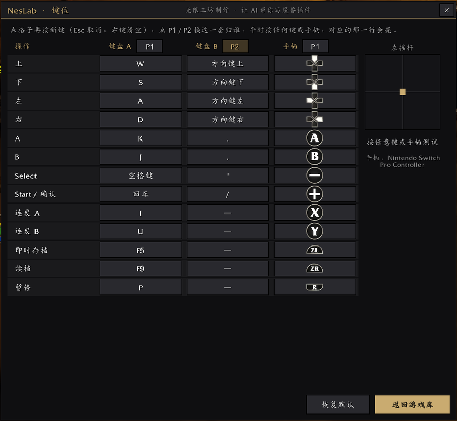
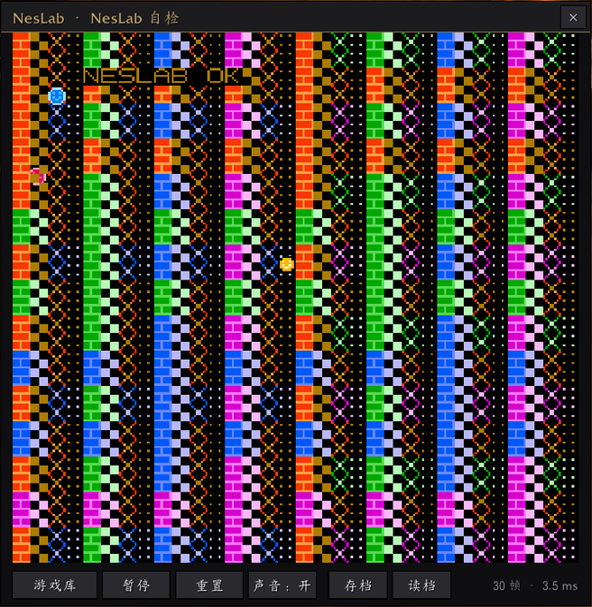

# NesLab · 魔兽里的 NES 游戏机

在《魔兽世界》无限（国服 Interface 16001）里玩 NES / FC 游戏的插件：6502 CPU、图块层 PPU、按音符播放的声音，
带游戏库、即时存档、连发、双人、手柄和键位设置。

*NesLab is a NES emulator that runs inside World of Warcraft (client "Wuxian", Interface 16001). Bring your own ROMs, convert them with `tools/nes2cart.py`, then open `/neslab` in game.*




## 能做什么

- **游戏库**：封面卡片、搜索、记住玩过几次；小地图按钮或 `/neslab` 打开
- **即时存档**：每个游戏一格，F5 存、F9 读；带电池的卡带自动存档
- **连发**：A / B 各一个连发键
- **双人**：键盘 A、键盘 B、手柄三套键位，每套可以给 P1 或 P2（默认 WASD = P1，方向键 = P2）
- **手柄**：开着游戏的手柄模式就能用，窗口开着时手柄只管模拟器，不会让角色乱动
- **键位设置与测试**：每个键都能改，按下时对应的那一行会亮
- **声音**：方波、三角波、噪声按音符播放事先合成的音色；DMC（鼓点、人声采样）可以从卡带里还原原声

## 支持的卡带

| mapper | 名字 |
|---|---|
| 0 | NROM |
| 1 | MMC1 |
| 2 | UxROM |
| 3 | CNROM |
| 4 | MMC3 |
| 7 | AxROM |
| 34 | BNROM |
| 66 | GxROM |
| 140 | Jaleco |

图案写死在卡带里（CHR ROM）和运行时才写进去（CHR RAM，比如大部分 UxROM）的卡带都支持。

## 安装

1. 把 `NesLab` 文件夹放进 `World of Warcraft\_cn_beta_\Interface\AddOns\`。
2. 想先试试的话，把 `NesLab_demo`（自检卡带）也放进去。`NesLab_mmc1` 是 MMC1 自检，`NesLab_Dev` 是开发用的 CPU 测试和测速，都可以不装。
3. 进游戏，点小地图上的遥控器按钮，或者输入 `/neslab`。

## 添加游戏

NesLab **不带任何游戏**。请使用你自己合法拥有的 ROM（`.nes` 文件）。

1. 装 Python 3.8 以上，再装依赖：
   ```bash
   pip install -r requirements.txt
   ```
2. 转换：
   ```bash
   python NesLab/tools/nes2cart.py 游戏.nes mygame "游戏名"
   ```
   - `mygame` 是卡带编号（只能用字母和数字），存档按它记；
   - 会在 `AddOns` 里生成一个 `NesLab_<游戏名拼音>` 文件夹，就是这张卡带；
   - 可选 `--cover 标题画面.png` 给游戏库加封面。
3. **重启游戏**（新文件夹要重启才认），在游戏库里打开。

### 图案在运行时写入的卡带（CHR RAM）

魔兽里没法在运行时生成贴图，所以转换时会先在电脑上把游戏跑几分钟（看演示、乱按手柄），收集它写过的所有图块，烘成贴图。需要多装一个 `lupa`（已在 `requirements.txt` 里）。

跑的时候没走到的画面，游戏里会缺几个图块（显示成空白），模拟器会记下来。退出游戏后运行：

```bash
python NesLab/tools/chrlearn.py
```

把记下的图块补进贴图，下次启动游戏就画得出来。

### DMC 原声（可选）

有的游戏用 DMC 声道放鼓点、人声。第一次玩时先用噪声代替，模拟器会记下用到了哪些采样。退出游戏后运行：

```bash
python NesLab/tools/dmc2ogg.py
```

它会从卡带里还原出原声，放进卡带文件夹的 `dmc\`，下次启动游戏就能听到。需要 [ffmpeg](https://ffmpeg.org/)（带 libvorbis）在 PATH 里。

## 默认按键

| 操作 | 键盘 A（P1） | 键盘 B（P2） | 手柄（P1） |
|---|---|---|---|
| 方向 | W A S D | 方向键 | 十字键 / 左摇杆 |
| A / B | K / J | `.` / `,` | 右键 / 下键 |
| Select / Start | 空格 / 回车 | `'` / `/` | − / + |
| 连发 A / B | I / U | | 上键 / 左键 |
| 存档 / 读档 | F5 / F9 | | ZL / ZR |
| 暂停 | P | | R |

M 静音，Esc 菜单。都可以在游戏库的「键位」里改。

## 开发

- `NesLab/tools/make_samples.py`：重新生成 `sound\` 里的音色（要 ffmpeg）
- `NesLab/tools/make_demo.py`、`make_demo_mmc1.py`：用自带的小汇编器 `nesasm.py` 生成两张自检卡带
- `NesLab/tools/nescovers.py`：把一批按编号命名的截图和 ROM 自动对上，生成封面对照表（`nes2cart.py --covers`）
- `NesLab_Dev`：`/neslab bench` 测速；CPU 用 [nestest](https://www.qmtpro.com/~nes/misc/nestest.txt)（kevtris）逐行对照

## 制作

NesLab 是 AI 用 [无限工坊](https://wuxianwow.com/workshop) 写出来、调试好的：无限工坊把 AI 连上你的游戏，写插件、改插件、看报错、截图调试。

## 许可证

[MIT](LICENSE)。`NesLab_Dev/NestestData.lua` 里的 nestest 测试程序和记录由 kevtris 编写，是 NES 模拟器开发常用的公开测试。
